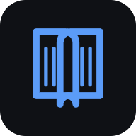
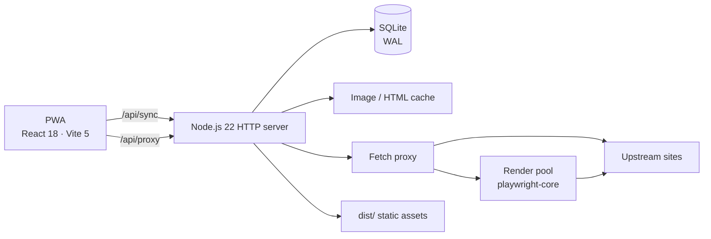

<p align="right">
  <strong>English</strong> · <a href="./README.zh-CN.md">简体中文</a>
</p>

<div align="center">
  
  <h1>Zeno</h1>
  <p><strong>A clean, self-hosted comic reader for every screen.</strong></p>
  <p>Installable PWA · Multi-device sync · Pluggable sources · Offline-first</p>

  <p>
    <a href="https://github.com/ZikiP/Zeno/actions/workflows/ci.yml"></a>
    <a href="./LICENSE"></a>
    
    
  </p>
</div>

> **Zeno is a reader framework, not a content provider.** This repository ships no comics, no sources, and no default plugins. You bring your own declarative plugin JSON. Read [DISCLAIMER.md](./DISCLAIMER.md) before use.

<details>
<summary>Contents</summary>

- [Overview](#overview)
- [Why Zeno](#why-zeno)
- [Features](#features)
- [Quick start](#quick-start)
- [Deployment](#deployment)
- [Configuration](#configuration)
- [Architecture](#architecture)
- [Sync and data](#sync-and-data)
- [Content sources](#content-sources)
- [Security and privacy](#security-and-privacy)
- [Development and testing](#development-and-testing)
- [Project layout](#project-layout)
- [Documentation](#documentation)
- [Contributing](#contributing)
- [License](#license)

</details>

## Overview

Zeno turns a source you already read into a focused reading experience: a bookshelf, search, offline storage, and a reader designed for phones, tablets, and desktops. One Node.js process serves the web app, the sync API, and the fetch proxy. A SQLite database keeps your library, progress, bookmarks, and preferences in one place.

Content is supplied by **declarative JSON plugins**. A plugin describes where pages live and how to parse them; it is not executable code. Zeno does not bundle, recommend, or ship a source.

**Status:** v0.6.0, actively developed. The core reader and multi-device sync are stable; the plugin format stays within `zeno-plugin@1` and is documented below.

> The web UI is currently in Simplified Chinese. Menu names below are quoted in Chinese with an English gloss.

## Why Zeno

- **Reader first.** Minimal chrome, two reading modes, keyboard shortcuts, touch gestures, and per-book preferences that stay out of the way.
- **Local-first.** The app works from IndexedDB and a Service Worker; the server keeps an image cache and consistent database backups. A network hiccup is not a blank page.
- **Your sources, your rules.** Sources are shareable JSON files. A site redesign means editing a plugin, not waiting for a release.
- **One small machine.** Node.js 22 + SQLite, no external queue or database. Put it on a mini PC and reach it over Tailscale.

## Features

| Area | What you get |
|---|---|
| **Library** | Bookshelf, update badges, cross-source search, chapter lists, reading progress, bookmarks with notes |
| **Reader** | Vertical scroll and paged modes; per-book mode memory; RTL/LTR; single or double page; preload; automatic image retry; pinch zoom; brightness; keep-awake |
| **Sync** | Multi-device library, progress, bookmarks, plugins, and per-book preferences; last-write-wins conflict handling; tombstones so deletions propagate |
| **Sources** | `zeno-plugin@1` JSON; `fetch` or real-browser rendering; per-page-type rules; plugin validation CLI; optional plugin repository sync |
| **PWA** | Installable on mobile, offline reading, Service Worker image caching, light/dark/system themes |
| **Operations** | One-command deployment, health and metrics endpoints, rotating logs, automatic SQLite backups, disk image cache, SSRF protection |

### Reader highlights

- Per-book **reading mode** (scroll or paged) is stored independently and synced across devices.
- Chapter-end pull-down or tap to continue to the next chapter.
- Next-chapter **address-table preload** avoids a second render when you turn the page.
- Image cache and retry behavior are visible and recoverable; a failed image never becomes a blank screen.
- Desktop shortcuts: `←` `→` pages, `Space`/`F` toolbar, `D` direction, `B` bookmark, `C` chapters, `K` bookmarks, `+`/`-` brightness, `Esc` back.

## Quick start

### Self-host (recommended)

Requirements: **Node.js 22+**. No external database or broker.

```bash
git clone https://github.com/ZikiP/Zeno.git
cd Zeno
npm install
npm run serve
```

`npm run serve` builds the frontend and starts the server. Open `http://127.0.0.1:8788`, then import a plugin under **设置 → 内容源** (Settings → Sources). Zeno does not include one.

To reach it from other devices, expose it over HTTPS with Tailscale:

```bash
tailscale serve --bg 8788
```

Use the resulting `https://<machine>.<tailnet>.ts.net` address **without a port**. Plain `http://<host>:8788` works on the LAN, but browsers do not treat it as a secure context, so the Service Worker and PWA offline mode will silently fail.

> If you use a system proxy (Clash, FlClash, etc.), add `*.ts.net` to its bypass list. Otherwise the proxy intercepts Tailscale TLS and the page loads without its API.

### Local development

```bash
npm install

# terminal 1 — sync API + fetch proxy
npm start

# terminal 2 — Vite dev server, proxies /api to :8788
npm run dev
```

The Vite app runs on `http://localhost:5178`.

## Deployment

| Platform | Command | Service model |
|---|---|---|
| Linux / macOS | `./deploy.sh` | systemd |
| Windows | `.\deploy.ps1` | Scheduled Task, auto-restart |

The scripts check the environment, install dependencies, build, register autostart, run a health check, and configure Tailscale HTTPS.

```bash
./deploy.sh --port 9000        # different port
./deploy.sh --skip-tailscale   # skip HTTPS setup
./deploy.sh --uninstall        # remove service, keep data
```

```powershell
.\deploy.ps1 -RunAsUser        # run as the current user (S4U)
.\deploy.ps1 -SkipInstall      # reuse node_modules and dist, re-register only
.\deploy.ps1 -Mode none        # run in the foreground once
.\deploy.ps1 -Uninstall        # remove service, keep data
```

**Important on Windows:** plugins using `fetch.mode="browser"` need a real browser session. A Scheduled Task running as `NT AUTHORITY\SYSTEM` cannot start Edge/Chrome. Use `-RunAsUser` (S4U: still starts before login, no password stored). The health endpoint stays green even when rendering is broken, so do not use it as the only check.

**Important with proxies:** the deployment scripts read the Windows registry proxy configuration and warn when `*.ts.net` is missing from the bypass list. Change the proxy client's own bypass settings; editing `ProxyOverride` directly is overwritten when the client toggles the system proxy.

For Tailscale, HTTPS, data layout, and a troubleshooting table, see **[docs/DEPLOY.md](./docs/DEPLOY.md)**.

## Configuration

The common variables are below. The full reference is collapsed to keep this page readable.

| Variable | Default | Purpose |
|---|---|---|
| `PORT` | `8788` | HTTP listen port |
| `DIST_DIR` | `dist` | Static frontend directory; use an absolute path under a service manager |
| `DB_PATH` | `data/zeno.db` | SQLite database; use an absolute path under a service manager |
| `SYNC_TOKEN` | empty | If set, sync and proxy endpoints require a Bearer token |
| `CORS_ORIGINS` | empty | Comma-separated frontend origins for split deployments; same-origin by default |
| `MAX_CONCURRENT` | `8` | Concurrent upstream fetches |
| `ZENO_BROWSER` | auto-detect | Chromium-family browser for `fetch.mode="browser"` |
| `BROWSER_MAX_PAGES` | `3` | Concurrent rendered pages |
| `ZENO_CACHE_DIR` | `cache/` beside the DB | Server image cache directory |
| `ZENO_CACHE_MAX_MB` | `512` | Image cache cap; `0` disables it |
| `ZENO_BACKUP_MS` | `86400000` | Automatic backup interval; `0` disables |
| `ZENO_BACKUP_KEEP` | `7` | Number of backups to retain |
| `ZENO_LOG_FILE` | empty | Enables the rotating file log; the deploy wrapper sets it to `zeno.log` |
| `ZENO_LOG_MAX_BYTES` | `5242880` | Rotate the log after this size |
| `ZENO_LOG_KEEP` | `5` | Number of log archives to retain |

<details>
<summary><strong>Full environment reference</strong></summary>

| Variable | Default | Purpose |
|---|---|---|
| `PORT` | `8788` | HTTP listen port |
| `DIST_DIR` | `dist` | Static frontend directory |
| `DB_PATH` | `data/zeno.db` | SQLite path |
| `SYNC_TOKEN` | empty | Bearer token for sync and proxy APIs |
| `CORS_ORIGINS` | empty | Allowed frontend origins for split deployments |
| `ALLOWED_HOSTS` | empty | Extra upstream hosts; plugin hosts are added automatically |
| `MAX_CONCURRENT` | `8` | Upstream fetch concurrency |
| `UPSTREAM_TIMEOUT_MS` | `20000` | Upstream request timeout |
| `ALLOW_PRIVATE_HOSTS` | off | Allow loopback/private targets. **Development and tests only** |
| `ZENO_BROWSER` | auto-detect | Browser executable path |
| `BROWSER_IDLE_MS` | `180000` | Close an idle render browser after this delay |
| `BROWSER_MAX_PAGES` | `3` | Concurrent rendered pages |
| `BROWSER_CHALLENGE_MS` | `10000` | Budget for a site's browser challenge |
| `RENDER_WAIT_MS` | `8000` | How long interactive requests wait for a render slot |
| `RENDER_QUEUE_MAX` | `20` | Render queue limit; beyond this returns 429 |
| `PARSE_TIMEOUT_MS` | `3000` | Chapter parser worker timeout |
| `PAGE_MAX_BYTES` | `8388608` | Maximum HTML returned by fetch/render |
| `HTML_CACHE_MS` | `600000` | In-process chapter HTML cache TTL |
| `HTML_CACHE_MAX` | `120` | Maximum cached chapter pages |
| `HTML_CACHE_MAX_BYTES` | `33554432` | Total chapter HTML cache size |
| `ZENO_FONT_GZIP_MAX_MB` | `24` | Font gzip cache size |
| `RENDER_TTL_MS` | `90000` | Render result cache TTL; `0` disables |
| `ZENO_CACHE_DIR` | `cache/` beside the DB | Image cache directory |
| `ZENO_CACHE_MAX_MB` | `512` | Image cache cap in MB; `0` disables |
| `ZENO_UPDATE_CHECK_MS` | `43200000` | Update-check interval; `0` disables |
| `ZENO_UPDATE_BOOK_MS` | `21600000` | Minimum interval per book |
| `ZENO_UPDATE_GAP_MS` | `500` | Pause between books during an update round |
| `ZENO_UPDATE_START_DELAY_MS` | `60000` | Delay before the first update round |
| `ZENO_BACKUP_MS` | `86400000` | Automatic backup interval; `0` disables |
| `ZENO_BACKUP_KEEP` | `7` | Backups retained |
| `ZENO_BACKUP_DIR` | `backups/` beside the DB | Backup directory |
| `ZENO_LOG_FILE` | empty | Rotating file log path |
| `ZENO_LOG_MAX_BYTES` | `5242880` | Log rotation threshold |
| `ZENO_LOG_KEEP` | `5` | Log archives retained |

</details>

## Architecture



- **Frontend:** React 18 + TypeScript + Vite, with IndexedDB and a Workbox Service Worker.
- **Backend:** one `node:http` process serving static files, the sync API, and the fetch proxy.
- **Storage:** SQLite in WAL mode; the image cache and backups live on disk.
- **Rendering:** `playwright-core` drives an installed Edge/Chrome only when a plugin asks for browser rendering. It is not a general-purpose browser farm, and it does not attempt anti-bot evasion.

## Sync and data

- **SQLite + WAL** for the server-side source of truth. The client's primary data lives in IndexedDB; the server is the sync hub.
- **Last-write-wins** per entity, with timestamps normalized against the server clock. Deletions use tombstones so another device cannot resurrect them.
- **Per-book preferences** are stored as one row per book. Reading mode uses its own `readerMode:<plugin>/<slug>` key so changing the mode cannot overwrite a simultaneous change to layout or direction on another device.
- **Idle sync fast path:** when nothing changed since the last pull, the server returns an `unchanged` snapshot (about 185 bytes) instead of the full library (about 52 KB for a typical library). A real change still returns a full snapshot.
- **Offline changes** stay local and are pushed on the next successful sync.

### Operations

- **Backups:** `VACUUM INTO` snapshots on a schedule, retained by count; set `ZENO_BACKUP_MS=0` to disable.
- **Logs and metrics:** optional size-based rotation; `GET /api/metrics` returns memory use, request counts, and per-route latency.
- **Image cache:** one Service Worker cache per device plus a shared server disk cache; the server cache keeps already-read images available when upstream is down.
- **Update badges:** the server's chapter count minus the client's cached count; opening a book re-aligns the baseline.

## Content sources

A plugin is JSON with the `zeno-plugin@1` format. It describes URL templates and parsing rules; it is not JavaScript.

```json
{
  "format": "zeno-plugin@1",
  "meta": { "id": "example", "name": "Example" },
  "entry": "https://example.com",
  "chapterHost": "https://example.com",
  "urls": {
    "search": "/search?q={q}",
    "detail": "/comic/{slug}",
    "chapter": "/comic/{slug}/{id}.html"
  },
  "parse": {
    "card": "<div class=\"comic-card",
    "slugFrom": "href=\"/comic/([^\"?]+)\"",
    "title": { "attr": "title" },
    "cover": "https?://[^\"'\\s]*?/cover/[^\"'\\s?]+\\.jpg",
    "chapterItem": "class=\"chapter-item\"",
    "chapterIdFrom": "/(\\d+)_(\\d+)\\.html",
    "imageAttr": "data-src"
  },
  "imageHosts": ["cdn.example.com"],
  "fetch": { "mode": "browser", "waitFor": ".comic-card" }
}
```

<details>
<summary><strong>Plugin fields, fetch modes, and common pitfalls</strong></summary>

### Fields

| Field | Purpose |
|---|---|
| `entry` | Entry hostname |
| `chapterHost` | Chapter-page hostname; defaults to `entry` |
| `urls.*` | URL templates: `{q}`, `{slug}`, `{id}`; `classify` variables come from `filters` |
| `filters` | Discovery filters declared by the site. The `key` must match a `{key}` in `classify`; omit the field for no filters |
| `parse.card` | String split marker. Use the **opening tag**, e.g. `<div class="comic-card`, not a CSS selector |
| `parse.slugFrom` | Regex with one capture group for the work slug |
| `parse.title` | `{ "attr": "title" }` or `{ "tag": "h3" }` |
| `parse.cover` | Regex for the cover URL |
| `parse.coverSizing` | Optional cover URL suffix, e.g. `?w={w}&h={h}&q=85`. Omit unless the CDN actually supports it |
| `parse.chapterItem` | Class or fixed href fragment identifying chapter links |
| `parse.chapterIdFrom` | Two capture groups = section + index; one group = the whole id |
| `parse.imageAttr` | Attribute containing the real image URL |
| `imageHosts` | Image CDN suffixes used for the proxy allowlist and cache |
| `fetch.mode` | `fetch` (default) or `browser`; may be an object keyed by `list` / `detail` / `chapter` |
| `fetch.waitFor` | Browser mode: wait for this selector |
| `fetch.minCount` | Browser mode: wait until this many matching elements exist |
| `fetch.capture` | Browser mode: capture image URLs from the site's own `JSON.parse` data instead of the DOM |
| `fetch.timeoutMs` | Per-fetch timeout; default 20000 |
| `headers` | Forwarded `User-Agent`, `Accept`, `Accept-Language`, `Referer`; cookies and authorization are never forwarded |

### `fetch` vs `browser`

| | `fetch` | `browser` |
|---|---|---|
| Page cost | 1–3 s | About 1 s with a warm session; first challenge can take several seconds |
| Retries | 3 | 1 |
| Cache | `max-age=600` | `no-store` |
| Concurrency | `MAX_CONCURRENT` | `BROWSER_MAX_PAGES` |
| Memory | negligible | 300–500 MB when warm; closes when idle |

Use `browser` only for pages that genuinely need JavaScript. Rendering a chapter page that already returns HTML is slower and adds no value.

### Common pitfalls

1. `parse.card` is a **string split marker**, not a CSS selector. Use the opening tag.
2. Real image URLs are often in `data-src` or `data-original`, not `src`.
3. The number of capture groups in `chapterIdFrom` decides the chapter id format and ordering.
4. Some sites HTML-encode `/`; Zeno decodes entities before parsing.
5. SSR pages may contain one real chapter link in the shell. Use `minCount` so `waitFor` does not stop too early.
6. Some sites only return usable HTML for a desktop user agent. Declare it in `headers`.
7. Flip-book readers may expose only a few images at a time. Use `fetch.capture` to read the URLs the site calculated itself. `capture` and `waitFor` are mutually exclusive.
8. Do not append `?w=&h=&q=` to covers unless the CDN supports it. Two real sites returned 503 for 11 seconds with sizing parameters and 200 in 1.6 seconds without them.

</details>

Validate a plugin without opening the UI:

```bash
node --import tsx scripts/verify-plugin.ts path/to/plugin.json
```

The verifier starts an isolated server by default, because browser-mode rendering happens on the server. Use `--direct` only for plugins that are entirely `fetch`.

### Plugin distribution

Plugins belong in a separate repository; this repo contains none. If you have one, the deployment scripts can pull it automatically:

```bash
ZENO_PLUGIN_REPO=owner/repo \
ZENO_PLUGIN_TOKEN=github_pat_xxx \
node --import tsx scripts/pull-plugins.mjs
```

| Variable | Default | Purpose |
|---|---|---|
| `ZENO_PLUGIN_REPO` | empty | `owner/name`; no default by design |
| `ZENO_PLUGIN_TOKEN` | empty | Read-only fine-grained PAT for private repositories |
| `ZENO_PLUGIN_REF` | `main` | Branch or tag |
| `ZENO_PLUGIN_DIR` | `plugins` | Directory containing plugin JSON files |
| `BASE` | `http://127.0.0.1:8788` | Target server |
| `SYNC_TOKEN` | empty | Required only if the server has one |

Invalid plugins are skipped, unchanged plugins are not re-pushed, and repository versions replace local versions with the same id. The script adds and updates; it does not delete plugins that are absent from the repository.

## Security and privacy

- **Network boundary:** designed for a private tailnet. Do not expose it to the public internet. Never use `tailscale funnel` for this service.
- **No default content source:** importing a plugin is an explicit action. The proxy allowlist is derived from installed plugins.
- **SSRF protection:** targets must resolve to public addresses. Loopback, RFC1918, link-local and cloud metadata ranges, CGNAT/Tailscale, multicast, and reserved ranges are rejected. Redirects are followed hop by hop and re-validated every time.
- **Residual risk:** validation happens before the request; DNS rebinding between validation and connection is not fully closed. The threat model is “a plugin file shared by someone else,” not a DNS-level adversary.
- **API surface:** same-origin CORS by default, JSON-only writes, optional Bearer token, and no `Access-Control-Allow-Origin: *`.
- **No anti-bot evasion:** browser rendering runs a real browser engine for JavaScript-rendered pages. It does not hide `navigator.webdriver`, forge fingerprints, or solve challenges.

Read [DISCLAIMER.md](./DISCLAIMER.md) for the legal boundary. You are responsible for how you use the tool and for the terms of the sites you access.

<details>
<summary><strong>Dependency advisory</strong></summary>

`npm audit` reports [GHSA-337j-9hxr-rhxg](https://github.com/advisories/GHSA-337j-9hxr-rhxg) for react-router 6. The affected path is SSR hydration / data-router `deserializeErrors()`. Zeno is a client-only SPA with no SSR, loaders, actions, or `HydratedRouter`, so that path is not reachable. The fix requires a breaking 6 → 7 migration and is intentionally deferred.

</details>

## Development and testing

```bash
npm run typecheck   # TypeScript
npm run build       # production build
npm test            # server/API/pure-logic suites
npm run icons       # regenerate PWA icons
```

`npm test` starts one isolated server and temporary database per suite. The browser-driven `verify-*` scripts and `stress-proxy` are intentionally outside CI because they depend on a local browser or real upstream sites.

CI runs `typecheck → build → test` on every push to `main` and on pull requests. See [CODE-STYLE.md](./CODE-STYLE.md) for module-size and structure conventions.

## Project layout

```text
src/                 React app, reader, stores, sync client
server/              Node HTTP server, sync API, proxy, render pool, SQLite
public/              PWA icons and static assets
scripts/             tests, plugin verification, benchmarks
docs/                deployment and operations notes
data/                runtime database, cache, backups (gitignored)
dist/                production build output (gitignored)
```

## Documentation

| Document | What it covers |
|---|---|
| [docs/DEPLOY.md](./docs/DEPLOY.md) | Self-hosting, Tailscale, Windows/Linux service details, troubleshooting (Simplified Chinese) |
| [CODE-STYLE.md](./CODE-STYLE.md) | Module boundaries and coding conventions (Simplified Chinese) |
| [DISCLAIMER.md](./DISCLAIMER.md) | Legal and content boundaries (Simplified Chinese) |
| [README.zh-CN.md](./README.zh-CN.md) | 简体中文版本 |

## Contributing

Issues and pull requests are welcome. Before opening a PR:

1. Keep the scope focused and describe the user-visible behavior.
2. Run `npm run typecheck`, `npm run build`, and `npm test`.
3. Follow [CODE-STYLE.md](./CODE-STYLE.md); small modules are preferred over large files.
4. Do not add content sources, site-specific workarounds, or anti-bot evasion to the main repository. Share sources as separate plugin files.

## License

[MIT](./LICENSE) © 2026 Zeno contributors.
