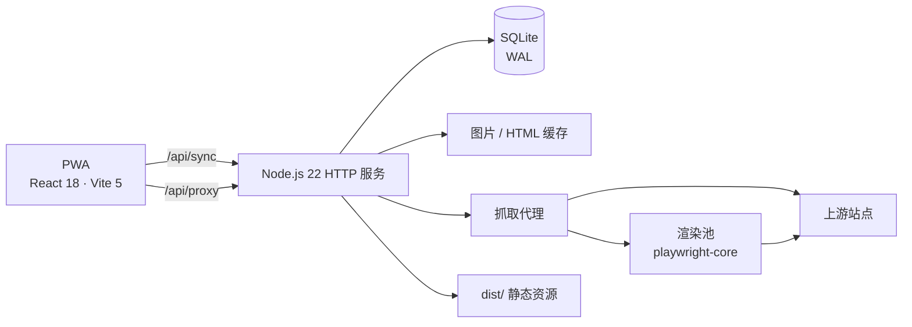

<p align="right">
  <a href="./README.md">English</a> · <strong>简体中文</strong>
</p>

<div align="center">
  
  <h1>Zeno</h1>
  <p><strong>干净的网页阅读器，为每一块屏幕而生。</strong></p>
  <p>可安装 PWA · 多端同步 · 可插拔内容源 · 离线优先</p>

  <p>
    <a href="https://github.com/ZikiP/Zeno/actions/workflows/ci.yml"></a>
    <a href="./LICENSE"></a>
    
    
  </p>
</div>

> **Zeno 是阅读器框架，不是内容平台。** 仓库不附带任何漫画、内容源或默认插件，内容源由你自行准备。使用前请阅读 [免责声明](./DISCLAIMER.md)。

<details>
<summary>目录</summary>

- [概览](#概览)
- [为什么是 Zeno](#为什么是-zeno)
- [功能](#功能)
- [快速开始](#快速开始)
- [部署](#部署)
- [配置](#配置)
- [架构](#架构)
- [同步与数据](#同步与数据)
- [内容源](#内容源)
- [安全与隐私](#安全与隐私)
- [开发与测试](#开发与测试)
- [项目结构](#项目结构)
- [文档](#文档)
- [贡献](#贡献)
- [许可证](#许可证)

</details>

## 概览

Zeno 把“在网页上看漫画”整理成一套专注的阅读体验：书架、搜索、离线缓存，以及为手机、平板和桌面分别调过的阅读器。一个 Node.js 进程同时提供网页、同步 API 和抓取代理；SQLite 保存书架、进度、书签和偏好，不需要额外的数据库或消息队列。

内容由**声明式 JSON 插件**提供。插件只描述“页面在哪里、怎么解析”，不是可执行代码。Zeno 不内置、不推荐、也不分发任何内容源。

**状态：** v0.6.0，持续开发中。阅读器与多端同步已稳定；插件格式保持在 `zeno-plugin@1` 内，详见下文。

## 为什么是 Zeno

- **阅读优先。** 克制的界面、两种阅读方式、键盘与触屏手势，以及按书保存的偏好，不抢内容的注意力。
- **本地优先。** 前端靠 IndexedDB 和 Service Worker 工作，服务端另有图片缓存与一致性数据库备份；网络波动不该等于白屏。
- **你的源，你的规则。** 内容源是可分享的 JSON。站点改版时改插件，不用等新版本。
- **一台小机器就够。** Node.js 22 + SQLite，没有外部队列和数据库；放在迷你主机上，用 Tailscale 访问。

## 功能

| 模块 | 能力 |
|---|---|
| **书架** | 书架、更新徽章、跨源搜索、章节列表、阅读进度、书签与笔记 |
| **阅读器** | 竖向滚动 / 左右翻页；按书记忆阅读方式；右起 / 左起；单页 / 双页；预加载；图片自动重试；双指缩放；亮度；屏幕常亮 |
| **同步** | 书架、进度、书签、插件和单书偏好多端同步；LWW 冲突处理；墓碑保证删除能传播 |
| **内容源** | `zeno-plugin@1` JSON；`fetch` 或真实浏览器渲染；按页面类型配置；插件校验 CLI；可选的插件仓库同步 |
| **PWA** | 手机可安装、离线阅读、Service Worker 图片缓存、浅色 / 深色 / 跟随系统 |
| **运维** | 一键部署、健康与指标端点、日志轮转、SQLite 自动备份、图片磁盘缓存、SSRF 防护 |

### 阅读器要点

- **阅读方式按书记忆**（滚动 / 翻页），并且跨端同步。
- 章末下拉或点击直接接下一章。
- 提前取下一话的**地址表**，翻过去时省掉一次渲染。
- 图片缓存和重试可见、可恢复；单张失败不会变成整屏空白。
- 电脑端快捷键：`←` `→` 翻页，`Space`/`F` 工具栏，`D` 切换方向，`B` 收藏，`C` 目录，`K` 书签，`+`/`-` 亮度，`Esc` 返回。

## 快速开始

### 自托管（推荐）

要求：**Node.js 22+**。不需要外部数据库或消息队列。

```bash
git clone https://github.com/ZikiP/Zeno.git
cd Zeno
npm install
npm run serve
```

`npm run serve` 会构建前端并启动服务。打开 `http://127.0.0.1:8788`，然后在 **设置 → 内容源** 导入一个插件。仓库里没有自带插件。

要让手机、平板访问，用 Tailscale 提供 HTTPS：

```bash
tailscale serve --bg 8788
```

使用生成的 `https://<机器名>.<tailnet>.ts.net`，**不要带端口号**。局域网 `http://<主机>:8788` 也能打开，但浏览器不认为它是安全上下文，Service Worker 和 PWA 离线能力会静默失效。

> 如果开着 Clash / FlClash 等系统代理，请把 `*.ts.net` 加入代理软件的绕过列表。否则代理会接管 Tailscale 的 TLS，页面能打开但 API 请求全断。

### 本地开发

```bash
npm install

# 终端 1：同步 API + 抓取代理
npm start

# 终端 2：Vite 开发服务器，把 /api 转发到 :8788
npm run dev
```

前端地址是 `http://localhost:5178`。

## 部署

| 平台 | 命令 | 常驻方式 |
|---|---|---|
| Linux / macOS | `./deploy.sh` | systemd |
| Windows | `.\deploy.ps1` | 计划任务，崩溃自动重启 |

脚本会检查环境、安装依赖、构建、注册开机自启、跑健康检查，并配置 Tailscale HTTPS。

```bash
./deploy.sh --port 9000        # 换端口
./deploy.sh --skip-tailscale   # 不配置 HTTPS
./deploy.sh --uninstall        # 卸载服务，保留数据
```

```powershell
.\deploy.ps1 -RunAsUser        # 任务主体换成当前账号（S4U）
.\deploy.ps1 -SkipInstall      # 沿用 node_modules 与 dist，只重注册
.\deploy.ps1 -Mode none        # 前台跑一次
.\deploy.ps1 -Uninstall        # 卸载服务，保留数据
```

**Windows 上很重要：** 使用 `fetch.mode="browser"` 的插件需要真实浏览器会话；以 `NT AUTHORITY\SYSTEM` 运行的计划任务起不了 Edge/Chrome。请使用 `-RunAsUser`（S4U：开机即启动，不保存密码）。渲染坏掉时 `/api/health` 仍可能是绿的，不能只看健康检查。

**代理环境很重要：** 部署脚本会读 Windows 注册表里的代理配置，发现绕过列表缺 `*.ts.net` 会提示。请改代理软件自己的“绕过 / 直连”设置；直接改 `ProxyOverride` 会被代理软件下次切换系统代理时覆盖。

Tailscale、HTTPS、数据目录和故障排查表见 **[docs/DEPLOY.md](./docs/DEPLOY.md)**。

## 配置

常用变量如下，完整列表收在折叠区里，避免首页太长。

| 变量 | 默认值 | 作用 |
|---|---|---|
| `PORT` | `8788` | HTTP 监听端口 |
| `DIST_DIR` | `dist` | 前端静态目录；作为系统服务运行时建议绝对路径 |
| `DB_PATH` | `data/zeno.db` | SQLite 路径；同上，建议绝对路径 |
| `SYNC_TOKEN` | 空 | 设置后同步与代理端点要求 Bearer token |
| `CORS_ORIGINS` | 空 | 前后端分离部署时允许的前端 origin；默认同源 |
| `MAX_CONCURRENT` | `8` | 上游并发上限 |
| `ZENO_BROWSER` | 自动探测 | `fetch.mode="browser"` 使用的浏览器路径 |
| `BROWSER_MAX_PAGES` | `3` | 同时渲染的页面上限 |
| `ZENO_CACHE_DIR` | 数据库同级 `cache/` | 服务端图片缓存目录 |
| `ZENO_CACHE_MAX_MB` | `512` | 图片缓存上限；`0` 关闭 |
| `ZENO_BACKUP_MS` | `86400000` | 自动备份间隔；`0` 关闭 |
| `ZENO_BACKUP_KEEP` | `7` | 保留备份份数 |
| `ZENO_LOG_FILE` | 空 | 设置后启用轮转文件日志；部署包装会设为 `zeno.log` |
| `ZENO_LOG_MAX_BYTES` | `5242880` | 单个日志文件上限 |
| `ZENO_LOG_KEEP` | `5` | 保留日志归档份数 |

<details>
<summary><strong>完整环境变量</strong></summary>

| 变量 | 默认值 | 作用 |
|---|---|---|
| `PORT` | `8788` | HTTP 监听端口 |
| `DIST_DIR` | `dist` | 前端静态目录 |
| `DB_PATH` | `data/zeno.db` | SQLite 路径 |
| `SYNC_TOKEN` | 空 | 同步与代理 API 的 Bearer token |
| `CORS_ORIGINS` | 空 | 分离部署时允许的前端 origin |
| `ALLOWED_HOSTS` | 空 | 额外的上游域名；插件域名会自动并入 |
| `MAX_CONCURRENT` | `8` | 上游抓取并发 |
| `UPSTREAM_TIMEOUT_MS` | `20000` | 单次上游请求超时 |
| `ALLOW_PRIVATE_HOSTS` | 关 | 放行回环 / 内网目标。**仅供开发与测试** |
| `ZENO_BROWSER` | 自动探测 | 浏览器可执行文件路径 |
| `BROWSER_IDLE_MS` | `180000` | 渲染浏览器空闲多久后关闭 |
| `BROWSER_MAX_PAGES` | `3` | 同时渲染的页面上限 |
| `BROWSER_CHALLENGE_MS` | `10000` | 等待站点浏览器质询的预算 |
| `RENDER_WAIT_MS` | `8000` | 交互请求等待渲染槽的最长时间 |
| `RENDER_QUEUE_MAX` | `20` | 渲染排队上限，超过返回 429 |
| `PARSE_TIMEOUT_MS` | `3000` | 章节解析 worker 超时 |
| `PAGE_MAX_BYTES` | `8388608` | fetch / render 返回的 HTML 上限 |
| `HTML_CACHE_MS` | `600000` | 章节 HTML 进程内缓存时长 |
| `HTML_CACHE_MAX` | `120` | 章节 HTML 缓存条数 |
| `HTML_CACHE_MAX_BYTES` | `33554432` | 章节 HTML 缓存总大小 |
| `ZENO_FONT_GZIP_MAX_MB` | `24` | 字体 gzip 缓存大小 |
| `RENDER_TTL_MS` | `90000` | 渲染结果缓存时长；`0` 关闭 |
| `ZENO_CACHE_DIR` | 数据库同级 `cache/` | 图片缓存目录 |
| `ZENO_CACHE_MAX_MB` | `512` | 图片缓存上限（MB）；`0` 关闭 |
| `ZENO_UPDATE_CHECK_MS` | `43200000` | 追更检查间隔；`0` 关闭 |
| `ZENO_UPDATE_BOOK_MS` | `21600000` | 同一本书的最小检查间隔 |
| `ZENO_UPDATE_GAP_MS` | `500` | 一轮追更中每本书之间的间隔 |
| `ZENO_UPDATE_START_DELAY_MS` | `60000` | 首轮追更启动延迟 |
| `ZENO_BACKUP_MS` | `86400000` | 自动备份间隔；`0` 关闭 |
| `ZENO_BACKUP_KEEP` | `7` | 保留备份份数 |
| `ZENO_BACKUP_DIR` | 数据库同级 `backups/` | 备份目录 |
| `ZENO_LOG_FILE` | 空 | 轮转日志路径 |
| `ZENO_LOG_MAX_BYTES` | `5242880` | 日志轮转阈值 |
| `ZENO_LOG_KEEP` | `5` | 保留日志归档份数 |

</details>

## 架构



- **前端：** React 18 + TypeScript + Vite，IndexedDB 存主数据，Workbox Service Worker 管离线。
- **后端：** 一个 `node:http` 进程同时提供静态文件、同步 API 和抓取代理。
- **存储：** SQLite WAL 模式；图片缓存和备份落在磁盘。
- **渲染：** 只有插件声明 `browser` 时才用 `playwright-core` 驱动本机 Edge/Chrome；它不是通用浏览器农场，也不做任何反自动化伪装。

## 同步与数据

- **SQLite + WAL** 是服务端真源；客户端主数据在 IndexedDB，服务端是同步枢纽。
- **LWW（最后写入者胜）** 按实体合并，时间戳对齐服务端时钟；删除走墓碑，别的设备不会把已删数据推回来。
- **单书偏好** 一本书一行。阅读方式用独立的 `readerMode:<插件>/<slug>` 键，改模式不会覆盖另一台设备同时改的适配或方向。
- **空闲同步快路径：** 自上次拉取后没有变化时，服务端返回 `unchanged` 空快照（约 185 字节），而不是整库（典型书库约 52 KB）；真有变化时仍返回全量。
- **离线改动** 留在本地，下一次同步成功时推送。

### 运维

- **备份：** 定时用 `VACUUM INTO` 生成一致性快照，按份数保留；`ZENO_BACKUP_MS=0` 可关闭。
- **日志与指标：** 可选按大小轮转；`GET /api/metrics` 返回内存、请求数和按路由耗时。
- **图片缓存：** 每台设备一份 Service Worker 缓存，服务端另有一份共享磁盘缓存；服务端缓存让看过的图在上游不可用时仍能打开。
- **更新徽章：** 服务端章节数减去客户端缓存数；翻开一本书会把基线重新对齐。

## 内容源

插件是 `zeno-plugin@1` 格式的 JSON，只描述 URL 模板和解析规则，不是 JavaScript。

```json
{
  "format": "zeno-plugin@1",
  "meta": { "id": "example", "name": "示例站点" },
  "entry": "https://example.com",
  "chapterHost": "https://example.com",
  "urls": {
    "search": "/search?q={q}",
    "detail": "/comic/{slug}",
    "chapter": "/comic/{slug}/{id}.html"
  },
  "parse": {
    "card": "<div class=\"comic-card",
    "slugFrom": "href=\"/comic/([^\"?]+)\"",
    "title": { "attr": "title" },
    "cover": "https?://[^\"'\\s]*?/cover/[^\"'\\s?]+\\.jpg",
    "chapterItem": "class=\"chapter-item\"",
    "chapterIdFrom": "/(\\d+)_(\\d+)\\.html",
    "imageAttr": "data-src"
  },
  "imageHosts": ["cdn.example.com"],
  "fetch": { "mode": "browser", "waitFor": ".comic-card" }
}
```

<details>
<summary><strong>插件字段、取源方式与常见坑</strong></summary>

### 字段

| 字段 | 说明 |
|---|---|
| `entry` | 入口域名 |
| `chapterHost` | 章节页域名；留空则同 `entry` |
| `urls.*` | URL 模板：`{q}`、`{slug}`、`{id}`；`classify` 的变量由 `filters` 声明 |
| `filters` | 发现页筛选。`key` 必须与 `classify` 里的 `{key}` 对上；不需要筛选就省略 |
| `parse.card` | 字符串切分点。必须填**标签开头**，例如 `<div class="comic-card`，不是 CSS 选择器 |
| `parse.slugFrom` | 提取作品标识的正则，需要一个捕获组 |
| `parse.title` | `{ "attr": "title" }` 或 `{ "tag": "h3" }` |
| `parse.cover` | 提取封面地址的正则 |
| `parse.coverSizing` | 可选的封面尺寸后缀，例如 `?w={w}&h={h}&q=85`。CDN 不支持就别填 |
| `parse.chapterItem` | 章节条目的 class，或 href 里的固定片段 |
| `parse.chapterIdFrom` | 两组捕获 = 分区 + 序号；一组 = 整段就是 id |
| `parse.imageAttr` | 真实图片地址所在的属性 |
| `imageHosts` | 图片 CDN 后缀，用于代理白名单和缓存 |
| `fetch.mode` | `fetch`（默认）或 `browser`；也可以按 `list` / `detail` / `chapter` 分开写 |
| `fetch.waitFor` | browser 模式：等这个选择器出现 |
| `fetch.minCount` | browser 模式：等匹配元素攒够这个数量 |
| `fetch.capture` | browser 模式：从站点自己的 `JSON.parse` 数据里抓图片地址，而不是读 DOM |
| `fetch.timeoutMs` | 单次取源超时，默认 20000 |
| `headers` | 转发 `User-Agent`、`Accept`、`Accept-Language`、`Referer`；Cookie 与 Authorization 永远不转发 |

### `fetch` 与 `browser`

| | `fetch` | `browser` |
|---|---|---|
| 单页耗时 | 1–3 秒 | 会话已建立约 1 秒；首次过质询可能数秒 |
| 失败重试 | 3 次 | 1 次 |
| 缓存 | `max-age=600` | `no-store` |
| 并发 | `MAX_CONCURRENT` | `BROWSER_MAX_PAGES` |
| 内存 | 可忽略 | 热起来 300–500 MB；空闲后关闭 |

只有页面确实需要 JavaScript 时才用 `browser`。章节页本来就能直接返回 HTML 的，再渲染一遍只会更慢。

### 常见坑

1. `parse.card` 是**字符串切分点**，不是 CSS 选择器；要填标签开头。
2. 真实图片地址常在 `data-src` / `data-original`，而不是 `src`。
3. `chapterIdFrom` 的捕获组数量决定章节 id 的形态和排序方式。
4. 有的站会把 `/` 编码成 HTML 实体；Zeno 解析前会整份解码。
5. SSR 壳里可能已经有一条真章节链接，`waitFor` 会过早收摊；用 `minCount` 等够数量。
6. 有的站只对桌面 UA 返回正常 HTML；在 `headers` 里声明。
7. 翻页式阅读器同一时刻可能只挂几张图；用 `fetch.capture` 读站点自己算出来的地址。`capture` 与 `waitFor` 互斥。
8. 别随便给封面追加 `?w=&h=&q=`。实测有两个站带尺寸参数 11 秒回 503，去掉参数 1.6 秒回 200。

</details>

不开界面也能校验插件：

```bash
node --import tsx scripts/verify-plugin.ts path/to/plugin.json
```

脚本默认会起一个隔离服务端，因为 `browser` 模式渲染发生在服务端；只有全程 `fetch` 的插件才适合加 `--direct`。

### 插件分发

插件应放在独立仓库里，本仓库不附带。可以用部署脚本或手动拉取：

```bash
ZENO_PLUGIN_REPO=owner/repo \
ZENO_PLUGIN_TOKEN=github_pat_xxx \
node --import tsx scripts/pull-plugins.mjs
```

| 变量 | 默认值 | 说明 |
|---|---|---|
| `ZENO_PLUGIN_REPO` | 空 | `owner/name`；刻意不设默认值 |
| `ZENO_PLUGIN_TOKEN` | 空 | 私有库只读 fine-grained PAT |
| `ZENO_PLUGIN_REF` | `main` | 分支或 tag |
| `ZENO_PLUGIN_DIR` | `plugins` | 仓库里放插件 JSON 的目录 |
| `BASE` | `http://127.0.0.1:8788` | 目标服务端 |
| `SYNC_TOKEN` | 空 | 服务端设了才需要 |

不合格的插件会跳过；没变化的插件不会重推；仓库里同 id 的版本会整份覆盖本地版本。脚本只增改，不删除仓库里没有的插件。

## 安全与隐私

- **网络边界：** 面向私有 tailnet，不要暴露到公网，也**不要**对本服务使用 `tailscale funnel`。
- **不内置内容源：** 导入插件是明确动作；代理白名单从已安装的插件推导。
- **SSRF 防护：** 目标必须解析到公网地址。回环、RFC1918、链路本地与云元数据段、CGNAT/Tailscale、组播和保留段一律拒绝；3xx 逐跳跟随并重新校验。
- **残留风险：** 校验发生在请求前，DNS rebinding 窗口没有完全关闭。威胁模型是“别人分享给你的插件文件”，不是能控制 DNS 的定向攻击。
- **API 面：** 默认同源 CORS、只接受 JSON 写入、可选 Bearer token，不回 `Access-Control-Allow-Origin: *`。
- **不做反自动化伪装：** 浏览器渲染只负责执行 JavaScript 页面，不隐藏 `navigator.webdriver`、不伪造指纹、不破解质询。

法律边界见 [DISCLAIMER.md](./DISCLAIMER.md)。你对自己如何使用本工具、以及访问站点的服务条款负责。

<details>
<summary><strong>依赖告警说明</strong></summary>

`npm audit` 会报 react-router 6 的 [GHSA-337j-9hxr-rhxg](https://github.com/advisories/GHSA-337j-9hxr-rhxg)。受影响的是 SSR hydration / data router 的 `deserializeErrors()` 路径；Zeno 是纯客户端 SPA，没有 SSR、loader、action 或 `HydratedRouter`，这条路径不可达。修复需要 6 → 7 的破坏性升级，因此刻意暂缓。

</details>

## 开发与测试

```bash
npm run typecheck   # TypeScript 类型检查
npm run build       # 生产构建
npm test            # 服务端 / API / 纯逻辑测试
npm run icons       # 重新生成 PWA 图标
```

`npm test` 会为每个套件启动独立服务端和临时数据库。依赖浏览器或真实上游站点的 `verify-*` 与 `stress-proxy` 刻意不进 CI。

CI 在每次 push 到 `main` 和 PR 时运行 `typecheck → build → test`。模块划分与命名规范见 [CODE-STYLE.md](./CODE-STYLE.md)。

## 项目结构

```text
src/                 React 应用、阅读器、stores、同步客户端
server/              Node HTTP 服务、同步 API、代理、渲染池、SQLite
public/              PWA 图标与静态资源
scripts/             测试、插件校验、基准脚本
docs/                部署与运维文档
data/                运行时数据库、缓存、备份（gitignore）
dist/                生产构建产物（gitignore）
```

## 文档

| 文档 | 内容 |
|---|---|
| [docs/DEPLOY.md](./docs/DEPLOY.md) | 自托管、Tailscale、Windows/Linux 服务细节与故障排查 |
| [CODE-STYLE.md](./CODE-STYLE.md) | 模块边界与编码规范 |
| [DISCLAIMER.md](./DISCLAIMER.md) | 法律与内容边界 |
| [README.md](./README.md) | English version |

## 贡献

欢迎 Issue 和 PR。提交前请：

1. 控制改动范围，并说明用户能看到的行为变化。
2. 运行 `npm run typecheck`、`npm run build`、`npm test`。
3. 遵守 [CODE-STYLE.md](./CODE-STYLE.md)；优先拆小模块，而不是堆大文件。
4. 不要把内容源、站点专属 workaround 或反自动化逻辑加进主仓库；内容源请作为独立插件分享。

## 许可证

[MIT](./LICENSE) © 2026 Zeno contributors.
